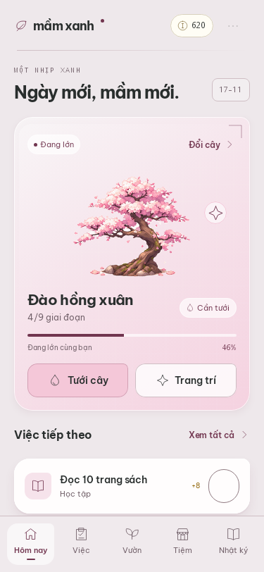
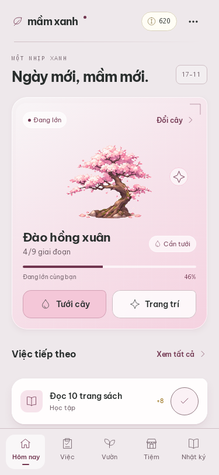
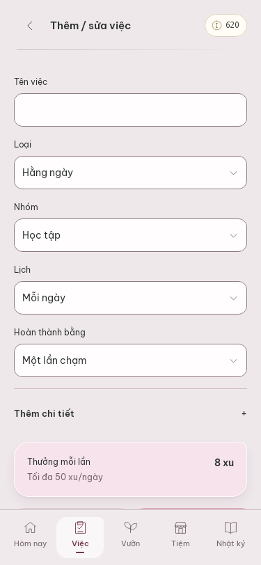
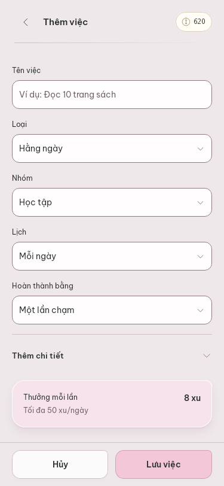
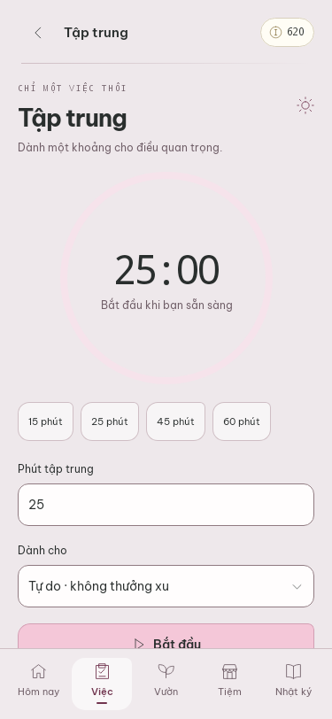
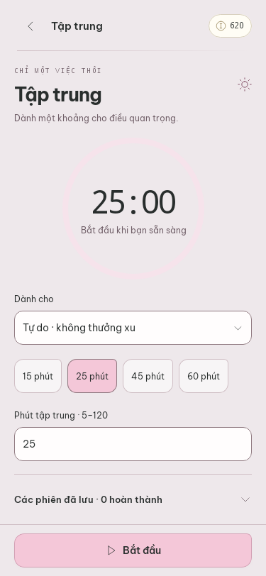
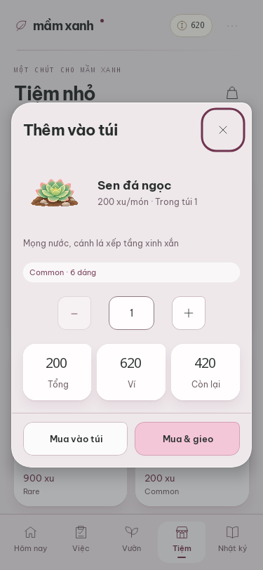
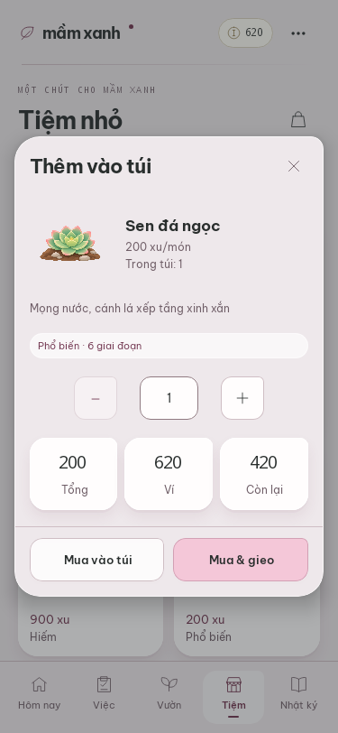

# Android UI audit images

144 final Compose captures and 127 original Android captures. These are Android-only before/after comparisons. See [the audit report](../ANDROID-AUDIT.md) for all 32 findings, fixes and verification limits. Download this folder and open index.html for the portable comparison gallery.

## home

| Before | After |
|---|---|
|  |  |

## task-new

| Before | After |
|---|---|
|  |  |

## focus

| Before | After |
|---|---|
|  |  |

## popup-seed-buy

| Before | After |
|---|---|
|  |  |

## All rendered states

| State | Before | After |
|---|---|---|
| home | [Image](audit-before/home.png) | [Image](home.png) |
| tasks | [Image](audit-before/tasks.png) | [Image](tasks.png) |
| garden | [Image](audit-before/garden.png) | [Image](garden.png) |
| shop | [Image](audit-before/shop.png) | [Image](shop.png) |
| stats | [Image](audit-before/stats.png) | [Image](stats.png) |
| task | [Image](audit-before/task.png) | [Image](task.png) |
| task-new | [Image](audit-before/task-new.png) | [Image](task-new.png) |
| inventory | [Image](audit-before/inventory.png) | [Image](inventory.png) |
| tree | [Image](audit-before/tree.png) | [Image](tree.png) |
| focus | [Image](audit-before/focus.png) | [Image](focus.png) |
| templates | [Image](audit-before/templates.png) | [Image](templates.png) |
| review | [Image](audit-before/review.png) | [Image](review.png) |
| rest | [Image](audit-before/rest.png) | [Image](rest.png) |
| insights | [Image](audit-before/insights.png) | [Image](insights.png) |
| achievements | [Image](audit-before/achievements.png) | [Image](achievements.png) |
| timeline | [Image](audit-before/timeline.png) | [Image](timeline.png) |
| settings | [Image](audit-before/settings.png) | [Image](settings.png) |
| data | [Image](audit-before/data.png) | [Image](data.png) |
| encyclopedia | [Image](audit-before/encyclopedia.png) | [Image](encyclopedia.png) |
| species | [Image](audit-before/species.png) | [Image](species.png) |
| onboard | [Image](audit-before/onboard.png) | [Image](onboard.png) |
| more | [Image](audit-before/more.png) | [Image](more.png) |
| shop-care | [Image](audit-before/shop-care.png) | [Image](shop-care.png) |
| shop-accessories | [Image](audit-before/shop-accessories.png) | [Image](shop-accessories.png) |
| inventory-care | [Image](audit-before/inventory-care.png) | [Image](inventory-care.png) |
| inventory-accessories | [Image](audit-before/inventory-accessories.png) | [Image](inventory-accessories.png) |
| tree-decor | [Image](audit-before/tree-decor.png) | [Image](tree-decor.png) |
| tree-info | [Image](audit-before/tree-info.png) | [Image](tree-info.png) |
| tasks-paused | [Image](audit-before/tasks-paused.png) | [Image](tasks-paused.png) |
| tasks-archived | [Image](audit-before/tasks-archived.png) | [Image](tasks-archived.png) |
| insights-detail | [Image](audit-before/insights-detail.png) | [Image](insights-detail.png) |
| insights-month | [Image](audit-before/insights-month.png) | [Image](insights-month.png) |
| popup-tree-picker | [Image](audit-before/popup-tree-picker.png) | [Image](popup-tree-picker.png) |
| popup-seed-picker | [Image](audit-before/popup-seed-picker.png) | [Image](popup-seed-picker.png) |
| popup-seed-buy | [Image](audit-before/popup-seed-buy.png) | [Image](popup-seed-buy.png) |
| popup-tool-buy | [Image](audit-before/popup-tool-buy.png) | [Image](popup-tool-buy.png) |
| popup-tool-owned | [Image](audit-before/popup-tool-owned.png) | [Image](popup-tool-owned.png) |
| popup-fertilizer-buy | [Image](audit-before/popup-fertilizer-buy.png) | [Image](popup-fertilizer-buy.png) |
| popup-accessory | [Image](audit-before/popup-accessory.png) | [Image](popup-accessory.png) |
| popup-plant | [Image](audit-before/popup-plant.png) | [Image](popup-plant.png) |
| popup-water-all | [Image](audit-before/popup-water-all.png) | [Image](popup-water-all.png) |
| popup-unlock | [Image](audit-before/popup-unlock.png) | [Image](popup-unlock.png) |
| popup-fertilizer-help | [Image](audit-before/popup-fertilizer-help.png) | [Image](popup-fertilizer-help.png) |
| popup-remove | [Image](audit-before/popup-remove.png) | [Image](popup-remove.png) |
| popup-sell | [Image](audit-before/popup-sell.png) | [Image](popup-sell.png) |
| popup-archive | [Image](audit-before/popup-archive.png) | [Image](popup-archive.png) |
| popup-discard | [Image](audit-before/popup-discard.png) | [Image](popup-discard.png) |
| popup-ticket | [Image](audit-before/popup-ticket.png) | [Image](popup-ticket.png) |
| popup-adjust | [Image](audit-before/popup-adjust.png) | [Image](popup-adjust.png) |
| popup-permission | [Image](audit-before/popup-permission.png) | [Image](popup-permission.png) |
| popup-permission-choice | [Image](audit-before/popup-permission-choice.png) | [Image](popup-permission-choice.png) |
| popup-permission-settings | [Image](audit-before/popup-permission-settings.png) | [Image](popup-permission-settings.png) |
| popup-clear | [Image](audit-before/popup-clear.png) | [Image](popup-clear.png) |
| popup-clear-final | [Image](audit-before/popup-clear-final.png) | [Image](popup-clear-final.png) |
| popup-recover | [Image](audit-before/popup-recover.png) | [Image](popup-recover.png) |
| popup-license | [Image](audit-before/popup-license.png) | [Image](popup-license.png) |
| popup-focus-end | [Image](audit-before/popup-focus-end.png) | [Image](popup-focus-end.png) |
| home-lavender | [Image](audit-before/home-lavender.png) | [Image](home-lavender.png) |
| home-orange | [Image](audit-before/home-orange.png) | [Image](home-orange.png) |
| onboard-1 | [Image](audit-before/onboard-1.png) | [Image](onboard-1.png) |
| onboard-2 | [Image](audit-before/onboard-2.png) | [Image](onboard-2.png) |
| onboard-3 | [Image](audit-before/onboard-3.png) | [Image](onboard-3.png) |
| onboard-4 | [Image](audit-before/onboard-4.png) | [Image](onboard-4.png) |
| task-new-expanded | [Image](audit-before/task-new-expanded.png) | [Image](task-new-expanded.png) |
| task-expanded | [Image](audit-before/task-expanded.png) | [Image](task-expanded.png) |
| settings-expanded | [Image](audit-before/settings-expanded.png) | [Image](settings-expanded.png) |
| data-expanded | [Image](audit-before/data-expanded.png) | [Image](data-expanded.png) |
| review-expanded | [Image](audit-before/review-expanded.png) | [Image](review-expanded.png) |
| species-expanded | [Image](audit-before/species-expanded.png) | [Image](species-expanded.png) |
| popup-seed-buy-bottom | [Image](audit-before/popup-seed-buy-bottom.png) | [Image](popup-seed-buy-bottom.png) |
| popup-plant-bottom | [Image](audit-before/popup-plant-bottom.png) | [Image](popup-plant-bottom.png) |
| popup-license-bottom | [Image](audit-before/popup-license-bottom.png) | [Image](popup-license-bottom.png) |
| home-320 | [Image](audit-before/home-320.png) | [Image](home-320.png) |
| tree-320 | [Image](audit-before/tree-320.png) | [Image](tree-320.png) |
| tasks-320 | [Image](audit-before/tasks-320.png) | [Image](tasks-320.png) |
| shop-320 | [Image](audit-before/shop-320.png) | [Image](shop-320.png) |
| popup-seed-320 | [Image](audit-before/popup-seed-320.png) | [Image](popup-seed-320.png) |
| home-844 | [Image](audit-before/home-844.png) | [Image](home-844.png) |
| tree-844 | [Image](audit-before/tree-844.png) | [Image](tree-844.png) |
| tasks-844 | [Image](audit-before/tasks-844.png) | [Image](tasks-844.png) |
| shop-844 | [Image](audit-before/shop-844.png) | [Image](shop-844.png) |
| popup-seed-844 | [Image](audit-before/popup-seed-844.png) | [Image](popup-seed-844.png) |
| achievements-full | [Image](audit-before/achievements-full.png) | [Image](achievements-full.png) |
| data-expanded-full | [Image](audit-before/data-expanded-full.png) | [Image](data-expanded-full.png) |
| data-full | [Image](audit-before/data-full.png) | [Image](data-full.png) |
| encyclopedia-full | [Image](audit-before/encyclopedia-full.png) | [Image](encyclopedia-full.png) |
| focus-full | [Image](audit-before/focus-full.png) | [Image](focus-full.png) |
| garden-full | [Image](audit-before/garden-full.png) | [Image](garden-full.png) |
| home-full | [Image](audit-before/home-full.png) | [Image](home-full.png) |
| home-lavender-full | [Image](audit-before/home-lavender-full.png) | [Image](home-lavender-full.png) |
| home-orange-full | [Image](audit-before/home-orange-full.png) | [Image](home-orange-full.png) |
| insights-detail-full | [Image](audit-before/insights-detail-full.png) | [Image](insights-detail-full.png) |
| insights-full | [Image](audit-before/insights-full.png) | [Image](insights-full.png) |
| insights-month-full | [Image](audit-before/insights-month-full.png) | [Image](insights-month-full.png) |
| inventory-accessories-full | [Image](audit-before/inventory-accessories-full.png) | [Image](inventory-accessories-full.png) |
| inventory-care-full | [Image](audit-before/inventory-care-full.png) | [Image](inventory-care-full.png) |
| inventory-full | [Image](audit-before/inventory-full.png) | [Image](inventory-full.png) |
| more-full | [Image](audit-before/more-full.png) | [Image](more-full.png) |
| onboard-1-full | [Image](audit-before/onboard-1-full.png) | [Image](onboard-1-full.png) |
| onboard-2-full | [Image](audit-before/onboard-2-full.png) | [Image](onboard-2-full.png) |
| onboard-3-full | [Image](audit-before/onboard-3-full.png) | [Image](onboard-3-full.png) |
| onboard-4-full | [Image](audit-before/onboard-4-full.png) | [Image](onboard-4-full.png) |
| onboard-full | [Image](audit-before/onboard-full.png) | [Image](onboard-full.png) |
| rest-full | [Image](audit-before/rest-full.png) | [Image](rest-full.png) |
| review-expanded-full | [Image](audit-before/review-expanded-full.png) | [Image](review-expanded-full.png) |
| review-full | [Image](audit-before/review-full.png) | [Image](review-full.png) |
| settings-expanded-full | [Image](audit-before/settings-expanded-full.png) | [Image](settings-expanded-full.png) |
| settings-full | [Image](audit-before/settings-full.png) | [Image](settings-full.png) |
| shop-accessories-full | [Image](audit-before/shop-accessories-full.png) | [Image](shop-accessories-full.png) |
| shop-care-full | [Image](audit-before/shop-care-full.png) | [Image](shop-care-full.png) |
| shop-full | [Image](audit-before/shop-full.png) | [Image](shop-full.png) |
| species-expanded-full | [Image](audit-before/species-expanded-full.png) | [Image](species-expanded-full.png) |
| species-full | [Image](audit-before/species-full.png) | [Image](species-full.png) |
| stats-full | [Image](audit-before/stats-full.png) | [Image](stats-full.png) |
| task-expanded-full | [Image](audit-before/task-expanded-full.png) | [Image](task-expanded-full.png) |
| task-full | [Image](audit-before/task-full.png) | [Image](task-full.png) |
| task-new-expanded-full | [Image](audit-before/task-new-expanded-full.png) | [Image](task-new-expanded-full.png) |
| task-new-full | [Image](audit-before/task-new-full.png) | [Image](task-new-full.png) |
| tasks-archived-full | [Image](audit-before/tasks-archived-full.png) | [Image](tasks-archived-full.png) |
| tasks-full | [Image](audit-before/tasks-full.png) | [Image](tasks-full.png) |
| tasks-paused-full | [Image](audit-before/tasks-paused-full.png) | [Image](tasks-paused-full.png) |
| templates-full | [Image](audit-before/templates-full.png) | [Image](templates-full.png) |
| timeline-full | [Image](audit-before/timeline-full.png) | [Image](timeline-full.png) |
| tree-decor-full | [Image](audit-before/tree-decor-full.png) | [Image](tree-decor-full.png) |
| tree-full | [Image](audit-before/tree-full.png) | [Image](tree-full.png) |
| tree-info-full | [Image](audit-before/tree-info-full.png) | [Image](tree-info-full.png) |
| popup-import-confirm | [Image](audit-before/popup-import-confirm.png) | [Image](popup-import-confirm.png) |
| audit-task-title-error | New audit state | [Image](audit-task-title-error.png) |
| audit-task-minutes-error | New audit state | [Image](audit-task-minutes-error.png) |
| audit-task-days-error | New audit state | [Image](audit-task-days-error.png) |
| audit-task-edit | New audit state | [Image](audit-task-edit.png) |
| audit-focus-45 | New audit state | [Image](audit-focus-45.png) |
| audit-focus-invalid | New audit state | [Image](audit-focus-invalid.png) |
| audit-focus-task | New audit state | [Image](audit-focus-task.png) |
| audit-templates-selected | New audit state | [Image](audit-templates-selected.png) |
| audit-large-text-home | New audit state | [Image](audit-large-text-home.png) |
| audit-large-text-popup | New audit state | [Image](audit-large-text-popup.png) |
| audit-large-text-form | New audit state | [Image](audit-large-text-form.png) |
| audit-landscape-focus | New audit state | [Image](audit-landscape-focus.png) |
| audit-landscape-home | New audit state | [Image](audit-landscape-home.png) |
| audit-large-text-species | New audit state | [Image](audit-large-text-species.png) |
| audit-tree-missing | New audit state | [Image](audit-tree-missing.png) |
| audit-busy-purchase | New audit state | [Image](audit-busy-purchase.png) |
| audit-large-text-species-bottom | New audit state | [Image](audit-large-text-species-bottom.png) |
